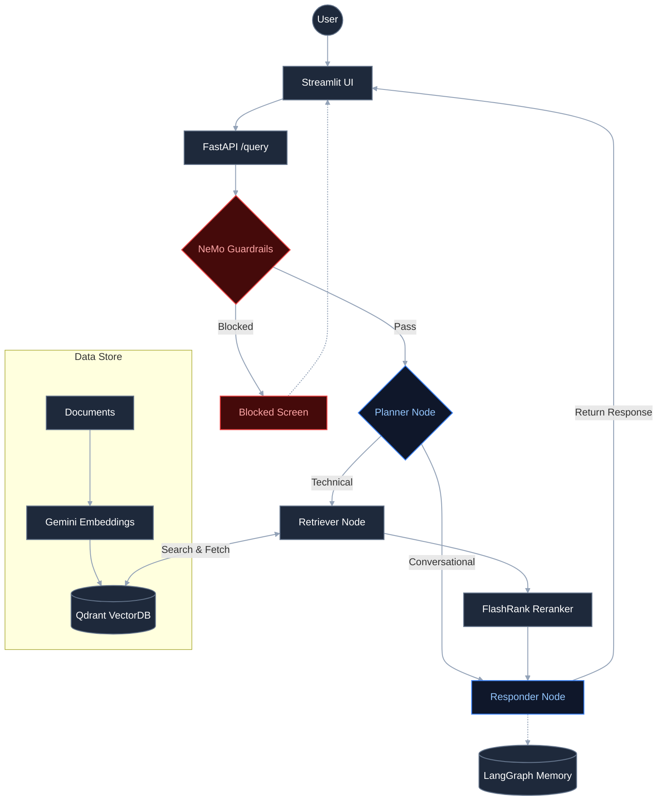

# Enterprise Technical Support Agentic RAG Assistant
A production-grade RAG System that helps to answer typical technical questions from complex large pool of technical documents with noisy data. It dynamically decides whether to retrieve documents or answer from conversation history. Generates answers grounded with citations. 

The chatbot also incorporates **guardrails**, **LangGraph-based orchestration**, **LLM Gateway integration**, **conversational memory**, **document citations**, and **retrieval reranking** to provide reliable and traceable technical answers.

## Key Features

- **Agentic Intelligence**: LangGraph for dynamic routing, multi-step planning, and conversation memory.
- **Guardrails**: NeMo Guardrails blocks off-topic, jailbreak, and injection inputs before they reach the planner node.
- **LLM Gateway**: Portkey reliably routes all LLM calls with automatic fallback across providers (like Groq and OpenRouter) and caches similar queries for faster response times.
- **Enterprise Search**: Qdrant Cloud to deliver low-latency, high-performance vector search at scale.
- **Reranking**: FlashRank for ultra-fast, local semantic reranking.
- **Gemini Embeddings**: Google Gemini embedding model with 3072 dimensions.
- **Document Parsing**: Parses documents in different formats, including PDF, HTML, TXT, DOCX, and PPTX.
- **Observability**: Full trace nesting with **Pydantic Logfire**.
- **Evaluation Suite**: RAGAS-powered evaluation pipeline (6 metrics) with a dedicated Streamlit demo app.

## Agentic RAG System Flow


## Tech stack

| Layer | Technology |
|-------|-----------|
| Orchestration | LangChain + LangGraph |
| LLMs | Groq (`gpt-oss-120b`) & Openrouter (`nemotron-3-super-120b-a12b`) via **Portkey** gateway |
| Guardrails | NeMo Guardrails |
| Vector DB | Qdrant Cloud |
| Reranking | FlashRank (local, zero-latency)  |
| Embeddings | Gemini `gemini-embedding-2-preview` (3072-dim) |
| Document Parsing | pypdf + pdfplumber (local, no OCR service) |
| Observability | Pydantic Logfire + LangSmith |
| Evaluation | RAGAS + custom Tool Correctness (Jaccard) |
| Backend Service | FastAPI framework|
| User Interface | Streamlit |

## Getting Started

### 1. Install dependencies

```powershell
python -m venv tenvv
.\tenvv\Scripts\activate
pip install -r requirements.txt
```

### 2. Configure environment

Create a `.env` file with the following keys:

```env
# Groq Reasoning Engine
GROQ_API_KEY = ""
GROQ_FALLBACK_API_KEY = ""          # second Groq key, or same as primary

# Portkey LLM Gateway
PORTKEY_API_KEY = ""

# Qdrant Vector DB
QDRANT_API_KEY = ""
QDRANT_CLUSTER_ENDPOINT = ""        # e.g. https://your-cluster.cloud.qdrant.io:6333

# Pydantic Logfire Observability
LOGFIRE_TOKEN = ""

# Streamlit UI → FastAPI
BACKEND_URL = ""                    # e.g. http://localhost:8000

# Eval judge LLM (keep separate from main key to avoid rate-limiting the live app)
JUDGE_GROQ = ""

# Gemini Embeddings
GEMINI_API_KEY = ""
```

### 3. Run data ingestion

Parses all documents in `DATA/`, chunks them, saves metadata to `processed_data/`, and indexes vectors into Qdrant.

```powershell
python -m app.ingestion.processor DATA --wipe
```

> Pass `--wipe` to drop and recreate the Qdrant collection. Omit it to append to an existing collection.

### 4. Launch the app

```powershell
# Terminal 1 — FastAPI backend
uvicorn app.main:app --reload --port 8000

# Terminal 2 — Streamlit UI
streamlit run ui/app.py
```

### 5. Run the eval suite (optional)

```powershell
# Requires the FastAPI backend running on :8000
streamlit run evals/app.py
```

## Evaluation Pipeline

### The 6 Metrics

```
  ┌──────────────────┬───────────────────┬─────────────────────┐
  │   RETRIEVAL      │    GENERATION     │   AGENT / PLANNER   │
  ├──────────────────┼───────────────────┼─────────────────────┤
  │ Context          │ Faithfulness      │ Tool Correctness    │
  │ Precision        │                   │                     │
  │                  │ Answer Relevancy  │ (Guardrails eval    │
  │ Context          │                   │  runs separately)   │
  │ Recall           │ Answer            │                     │
  │                  │ Correctness       │                     │
  └──────────────────┴───────────────────┴─────────────────────┘
```

### Metric Details

| # | Metric | Library | What it asks | Score = 1.0 means |
|---|--------|---------|-------------|-------------------|
| 1 | **Faithfulness** | RAGAS | Does every sentence in the answer come from the retrieved context? | Zero hallucination |
| 2 | **Answer Relevancy** | RAGAS | Does the answer directly address what was asked? | Perfectly on-topic |
| 3 | **Context Precision** | RAGAS | Are the useful chunks ranked above the noisy ones? | Best chunks ranked first |
| 4 | **Context Recall** | RAGAS | Did the retriever fetch all facts the reference answer needs? | Nothing important missed |
| 5 | **Answer Correctness** | RAGAS | Does the answer match the known ground-truth reference? | Factually identical |
| 6 | **Tool Correctness** | DeepEval | Did the agent call the right tools (no more, no less)? | Exact tool match |

---

### What Inputs Does Each Metric Need?

| Metric | `user_input` | `retrieved_contexts` | `response` | `reference` | Judge LLM? | Embeddings? |
|--------|:---:|:---:|:---:|:---:|:---:|:---:|
| Faithfulness | ✅ | ✅ | ✅ | ❌ | ✅ | ❌ |
| Answer Relevancy | ✅ | ✅ | ✅ | ❌ | ✅ | ✅ |
| Context Precision | ✅ | ✅ | ❌ | ✅ | ✅ | ❌ |
| Context Recall | ✅ | ✅ | ❌ | ✅ | ✅ | ❌ |
| Answer Correctness | ✅ | ❌ | ✅ | ✅ | ✅ | ✅ |
| Tool Correctness | ✅ | ❌ | ✅ | ❌ | ❌ | ❌ |

> ⚡ **Tool Correctness is fully deterministic** — it uses a Jaccard score (set overlap) between called tools and expected tools. Zero LLM calls, zero cost, no rate limits.

---

### Score Thresholds

| Score | Verdict | What to do |
|-------|---------|------------|
| ≥ 0.75 | 🟢 Good | Safe to ship |
| 0.50 – 0.74 | 🟡 Fair | Investigate before shipping |
| < 0.50 | 🔴 Poor | Fix before shipping |

---
